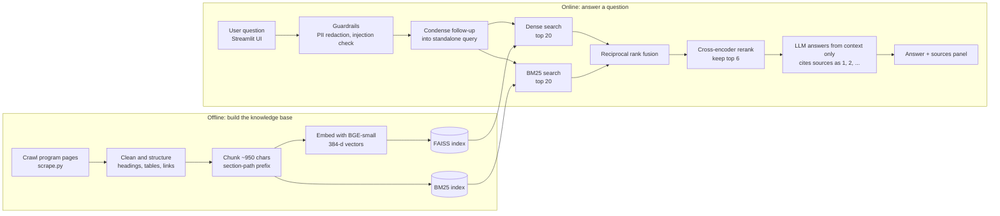

# Ask-ADS: A RAG Assistant for the UChicago MS in Applied Data Science

A retrieval-augmented chatbot that answers questions about the University of Chicago
**MS in Applied Data Science (MS-ADS)** program: tuition, scholarships, deadlines, admissions
requirements, curriculum, capstone and more. Answers are generated only from the official
program website and come with numbered citations.

> Unofficial student course project (GenAI Principles, Project 1). Not affiliated with or
> endorsed by the University of Chicago. Always confirm deadlines and costs on the official site.

**Knowledge source:** https://datascience.uchicago.edu/education/masters-programs/ms-in-applied-data-science/

---

## 1. System architecture



## 2. Repository structure

```text
adsbot/
├── app.py              # Streamlit chat UI (header, sample questions, sources panel)
├── rag.py              # Chunking, indexing, hybrid retrieval, reranking, LLM answer, guardrails
├── scrape.py           # Site crawler and HTML-to-structured-text extractor
├── eval.py             # Retrieval and answer evaluation on the course test set
├── requirements.txt    # Python dependencies
├── assets/
│   └── dsi_logo.svg    # Logo used in the UI header
├── data/
│   ├── pages.jsonl         # Crawled pages: url, title, sections
│   ├── chunks.json         # 500 chunks with metadata
│   ├── faiss.index         # Dense vector index
│   └── eval_results.json   # Latest evaluation output
└── .streamlit/
    └── config.toml     # Theme (UChicago maroon)
```

## 3. How it works

| Stage | What happens | Where |
|---|---|---|
| Crawl | Breadth-first crawl from four seed pages, restricted to program paths (admissions, deadlines, tuition, curriculum, FAQs, capstone). Also fetches the fee-waiver and Booth joint-degree pages. 29 pages in total. | `scrape.py` |
| Extract | Keeps headings, tables, link targets and accordion text. Course titles are tagged Core/Elective plus quarter. Navigation menus are dropped. | `scrape.py` |
| Chunk | Section-based chunks of about 950 characters with 120 overlap. Each chunk starts with `[Program] Page > Section`. Aggregate "list of core/elective courses" chunks answer list questions. Chunks are tagged by program so the separate Applied AI program does not leak into answers. | `rag.py: build_chunks` |
| Embed and store | `BAAI/bge-small-en-v1.5` embeddings in a FAISS inner-product index, plus a BM25 index for exact terms (TOEFL, STEM, dollar amounts). | `rag.py: build_index` |
| Retrieve | Dense and BM25 candidates are merged with reciprocal rank fusion, then a MiniLM cross-encoder reranks the top 20 and the best 6 go to the LLM. | `rag.py: Retriever.search` |
| Generate | The LLM sees only the numbered passages, answers at temperature 0, cites sources, and says so when the answer is not in the context. When rules differ for in-person and online programs, it states both. | `rag.py: SYSTEM, Bot.ask` |
| Interface | Streamlit chat with sample questions, conversation memory (follow-ups are rewritten into standalone queries) and an expandable sources panel. | `app.py` |

## 4. Responsible AI

- **Grounding:** answers come only from retrieved passages; unsupported questions get an honest "could not find" with a link to the official page, and no unrelated sources are shown.
- **PII redaction:** SSNs, card numbers, emails and phone numbers are masked before any model call.
- **Prompt-injection guard:** common override phrases are rejected, and retrieved text is treated as data, not instructions.
- **Transparency:** every answer shows its sources, and the UI reminds users to verify deadlines and costs.
- **Graceful degradation:** with no LLM key, the app falls back to showing the most relevant passages.

## 5. Evaluation

`eval.py` scores 15 questions: the 12 course sample questions plus 3 from the project brief.
Gold answers follow the live website, which has changed since the sample answers were written.

| Metric | Result |
|---|---|
| Retrieval Hit@1 (all gold facts in top 1 chunk) | 0.60 |
| Retrieval Hit@3 | 0.80 |
| Retrieval Hit@6 (what the LLM actually sees) | **1.00** |
| Mean reciprocal rank | 0.77 |
| Answer keyword recall (gpt-4o-mini, first run) | 0.87 |

Notes and limitations:
- Small test set, and the system was tuned on it, so the numbers are optimistic.
- Answer recall is a keyword match, which is crude: correct answers phrased differently can be undercounted.
- Several site details change over time; re-crawl before relying on the data.
- The website itself contains an odd TOEFL line ("102 prior or 5 current"), which the bot returns as written.

Re-run the evaluation:

```bash
python eval.py            # retrieval only
OPENAI_API_KEY=sk-... python eval.py --llm   # retrieval plus answer quality
```

## 6. Run locally

```bash
pip install -r requirements.txt
export OPENAI_API_KEY=sk-...        # or ANTHROPIC_API_KEY
streamlit run app.py
```

Optional environment variables: `LLM_MODEL` (default `gpt-4o-mini` for OpenAI, `claude-haiku-4-5` for Anthropic), `OPENAI_BASE_URL`.

Refresh the knowledge base after the website changes:

```bash
python scrape.py && python rag.py index
```

## 7. Deploy (Streamlit Community Cloud)

1. Push this repository to GitHub, including `data/`.
2. On share.streamlit.io choose **Create app**, pick the repo, branch `main`, main file `app.py`.
3. Under **Settings > Secrets** add:
   ```toml
   OPENAI_API_KEY = "sk-..."
   LLM_MODEL = "gpt-4o-mini"
   ```
4. After pushing code changes, use **Reboot app** so cached resources reload.

## 8. Roadmap

- Scheduled re-crawl with change detection.
- LLM-as-judge for faithfulness and relevance, and a larger labeled set.
- Structured extraction for deadlines, tuition and requirements tables.
- Clarifying questions for in-person versus online.
- User feedback buttons and logging.
